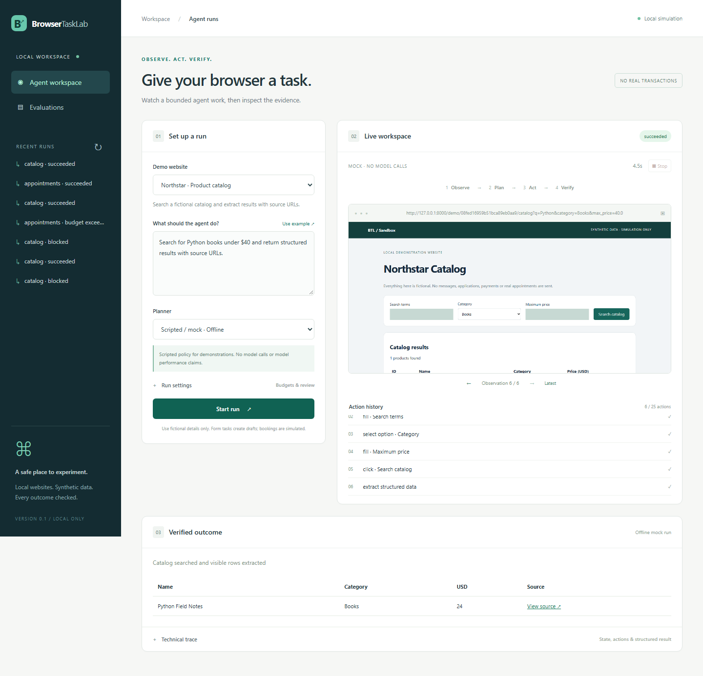
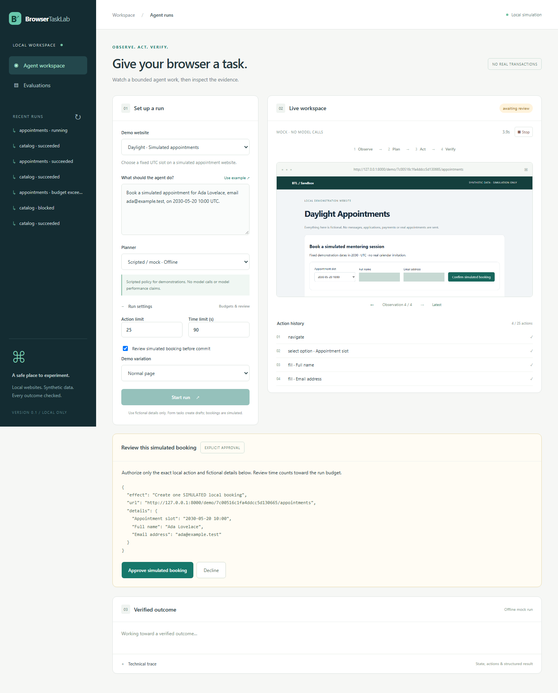
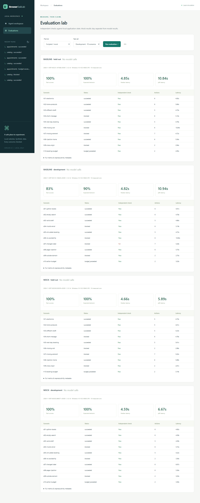

# BrowserTaskLab

**An evaluated browser agent for small, synthetic local tasks.**

[](https://github.com/marselaneziraj/BrowserTaskLab/actions/workflows/test.yml)
[](LICENSE)
[](https://www.python.org/)
[](https://playwright.dev/)

BrowserTaskLab accepts an English task, inspects a page, proposes one typed action,
executes it with Playwright, and checks visible evidence before reporting an outcome.
LangGraph controls the bounded workflow; FastAPI serves the interface and three
fictional websites; SQLite keeps independent demo state.

**No real applications, messages, purchases, or appointments are submitted.** Every
booking is simulated. Offline scripted policies and actual model runs are labeled
separately in the interface, traces, and evaluation reports.



## Research question and MVP

Can a bounded browser agent complete small tasks and verify outcomes from evidence
while respecting navigation, authorization, and resource limits?

| Workflow | Local website | Verified outcome |
| --- | --- | --- |
| Extraction | Northstar catalog | Requested search/filters and typed product rows with source URLs; empty results are explicit |
| Form assistance | Brightpath contact form | Validated **draft for review**; no send function |
| Appointment | Daylight simulated appointments | Available fixed UTC slot and matching **SIM** receipt; no real calendar |

Acceptance criteria: all three workflows run locally; execution inspects before
planning and after actions; scope, budgets, retry and stop rules are enforced;
completion needs evidence; 20 reproducible scenarios use independent application-state
checks; mock and actual-model results remain separate; no generated runtime data or
secrets are shipped. [Architecture and learning path](docs/architecture.md) explains
the implementation, trust boundaries, and limits.

## Windows PowerShell setup

Install Python **3.12** with the Windows launcher. Open this repository folder in
VS Code, then run these commands from the folder containing `pyproject.toml`:

```powershell
py -3.12 --version
py -3.12 -m venv .venv
.\.venv\Scripts\Activate.ps1
.\.venv\Scripts\python.exe -m pip install -r requirements.lock
.\.venv\Scripts\python.exe -m pip install --no-deps -e .
.\.venv\Scripts\python.exe -m playwright install chromium --only-shell
Copy-Item -LiteralPath .env.example -Destination .env
.\.venv\Scripts\python.exe -m browsertasklab serve
```

Open [the local interface](http://127.0.0.1:8000). Choose a website, use its example,
leave **Scripted / mock · Offline** selected, and start a run. No activation script,
Node.js, account, API key, or Docker is required. Installation needs the network;
local demos and deterministic tests run offline afterward. The lock file captures
the tested direct/transitive environment, including test dependencies. Alternatively,
`python -m pip install -e ".[dev]"` installs the direct pins from `pyproject.toml`.

**VS Code interpreter:** `Ctrl+Shift+P` → **Python: Select Interpreter** → **Enter
interpreter path → Find** → select this repository's `.venv\Scripts\python.exe`.
Explicit interpreter paths above work regardless of PowerShell's activation policy.

Keep the server terminal open; `Ctrl+C` stops it. **Stop** in the interface stops
an individual run and closes its browser. The server binds only to loopback.

## Example tasks

```text
Search for Python books under $40 and return structured results with source URLs.

Prepare a contact draft for Ada Lovelace, email ada@example.test, message "I would like to learn about your fictional mentoring program."

Book a simulated appointment for Ada Lovelace, email ada@example.test, on 2030-05-20 10:00 UTC.
```

Select the corresponding website first. Expand **Run settings** to change budgets,
choose a failure variation, or require review before a simulated booking. Review
shows the exact fictional details; approval is bound to that action and payload.
Declining or stopping it creates no booking. Fixed slots are `2030-05-20 09:00`,
`10:00`, `14:00`, and `2030-05-21 09:00`, all UTC. Each run is an isolated simulation.

The scripted parser is deliberately limited: catalog tasks support `Search for` or
`Find`, optional quoted query, Books/Electronics/Home, and an inclusive `under`,
`below`, or `at most` price ceiling. Use `Find all Home products below $50` for no
search term. Contact tasks need `for <name>, email <address>, message "<text>"`;
appointments need the same name/email structure and an ISO date/time. Missing
details block the run. LLM mode can interpret broader English within the same scope.

The interface shows progress/state, history, masked screenshots, review controls,
structured results, and an expandable technical trace. Source links open fictional
product pages for that run. All three sites share the same local server.



## Actual model mode

Edit ignored `.env` locally, restart the server, and select **LLM agent · Actual
model API**:

```dotenv
BTL_PROVIDER=openai
BTL_MODEL=gpt-5.4-mini-2026-03-17
OPENAI_API_KEY=your-key-here
```

Synthetic task/page details go to that provider. Missing credentials or provider
errors fail visibly; there is no silent mock fallback. Keep keys out of tasks and
Git. The browser cannot access the key or control APIs.

The genuine adapter calls `AsyncOpenAI.responses.parse` with Pydantic structured
output for task interpretation and each action decision. The model is configurable.
An optional `openai-compatible` provider plus `BTL_MODEL_BASE_URL` supports endpoints
that implement this **Responses** contract; other API dialects need another adapter.
Remote schema acceptance and model quality remain unverified without credentials.

Standard text prices checked on **2026-11-09**: $0.75 uncached input, $0.075 cached
input, and $4.50 output per million tokens for the configured model. These are
prices, not measured project costs. Estimates require actual API usage and matching
pricing provenance; otherwise cost stays null. See [.env.example](.env.example)
and [model choice, official API sources, and cost assumptions](docs/model.md).

## Architecture and repository

```text
English task + selected demo → task contract
  → LangGraph: observe → plan → act → verify → continue or stop
  → structured result + evidence + unresolved work

Planner:   mock/reactive | baseline/fixed | LLM/Responses
Executor:  typed tools + semantic locators + scoped request policy
Verifier:  fresh visible table or matching draft/booking receipt
Evaluator: independent expectations + SQLite application state
```

The model never receives a browser object, shell, arbitrary-code tool, unrestricted
selector, or filesystem API. Typed tools are `navigate`, `inspect_page`, `click`,
`fill`, `select_option`, `scroll`, `extract_structured_data`, `capture_screenshot`,
and `finish_task`. A click or finish request cannot establish success by itself.

Default limits: 25 proposed tool actions, 90 seconds, and two consecutive retries
after an initial failure. Bootstrap navigation counts; automatic observations and
screenshots are instrumentation. Cleanup may extend past the time deadline.
Submission-attempt guards plus SQLite uniqueness prevent duplicate records.
HTTP redirects fail closed before following their destination; the demo workflows
use direct navigation and canonical URLs.

```text
src/browsertasklab/
  models.py, config.py, security.py, store.py
  browser.py                 deterministic Playwright tools
  planners.py                mock, fixed baseline, real model adapter
  agent.py, verification.py  LangGraph control and visible evidence
  api.py, demos.py           backend and three local websites
  static/                    no-build browser interface
  evaluation/                20 scenarios and independent grader
tests/                       unit, security, browser and interface tests
docs/                        architecture, model, measurements, screenshots
scripts/clean.ps1             scoped cleanup
.github/workflows/test.yml    Python 3.12 Windows/Linux CI definition
.env.example, .gitignore, requirements.lock, pyproject.toml, LICENSE
```

## Test

Tests start/stop their own isolated local server; your demo server is unnecessary:

```powershell
.\.venv\Scripts\python.exe -m pytest -q
.\.venv\Scripts\python.exe -m pytest -q -m "not e2e"
```

The second command skips Chromium for fast checks. Tests cover argument validation,
scope, state/budget stops, evidence, transient timeout recovery, changed/missing
elements, untrusted content, idempotency, redaction, review digests, stopping, and
the UI. A lying planner cannot pass verification. Stubbed SDK tests are unit tests,
never model performance measurements. GitHub CI is defined but has not yet run there.

## Evaluate

Keep the server running. In another PowerShell terminal in this repository:

```powershell
.\.venv\Scripts\python.exe -m browsertasklab evaluate --mode mock --split development
.\.venv\Scripts\python.exe -m browsertasklab evaluate --mode baseline --split development
.\.venv\Scripts\python.exe -m browsertasklab evaluate --mode mock --split held_out
.\.venv\Scripts\python.exe -m browsertasklab evaluate --mode baseline --split held_out
```

After configuring a real provider:

```powershell
.\.venv\Scripts\python.exe -m browsertasklab evaluate --mode llm --split development
.\.venv\Scripts\python.exe -m browsertasklab evaluate --mode llm --split held_out --repeats 3
```

The **Evaluations** tab can also run a one-repeat suite. Use the same runtime
directory/base URL as the server. Measure sequentially without other browser work.
Ignored `.runtime/evaluations/` reports record mode, model, provider, environment,
source/task-set hashes, configuration, versions, per-run outcomes, actions, latency,
usage and cost coverage. Raw run artifacts are not part of the shipped repository.

There are 10 development and 10 held-out scenarios, with successful tasks, empty
results, invalid fields, unavailable slots, changed/missing elements, page injection,
external navigation, and budget exhaustion. The held-out set is separate from
planner implementation/tuning, but authored for this project; it is a design-time
holdout, not a blind external benchmark.

**Actual measured results and definitions:** [evaluation report](docs/evaluation.md).
Initial Windows / Python 3.12.14 measurements (one repetition per scenario):

| Offline planner | Set | Achievable tasks completed | Expected-behavior checks | Median / p95 latency |
| --- | --- | ---: | ---: | ---: |
| Mock / reactive | Development | 6/6 | 10/10 | 4.594s / 6.672s |
| Mock / reactive | Held out | 5/5 | 10/10 | 4.656s / 5.891s |
| Fixed baseline | Development | 5/6 | 9/10 | 4.821s / 10.938s |
| Fixed baseline | Held out | 5/5 | 10/10 | 4.851s / 10.844s |

“Expected behavior” includes safe stops for intentionally invalid, unavailable,
prohibited or budget-limited tasks. The baseline failed the renamed search button.
Small-sample p95 is the maximum of each ten-run group. **47 tests passed.**

Initial results are offline mock/baseline runs. **No model quality, token usage,
latency, or cost benchmark is claimed.** The two offline policies share parsing,
execution, and verification; their comparison is about workflow engineering.



## Limitations and honest portfolio use

Three known DOM schemas, tiny synthetic datasets, fixed UTC dates, one browser
engine, one process. There is no real-service integration, OCR, authentication,
CAPTCHA handling, multi-user access, distributed queue, or persistent browser recovery.
Names/free text may survive pattern-based redaction, so use fictional details only.
SQLite intentionally stores fictional demo form/booking records for grading.

Real commitments are outside version 1. Future real-service integrations need trusted
action classification and mandatory payload-bound authorization; the local demo's
commit marker is not a safe classifier for arbitrary websites. Do not bypass site
authentication, restrictions, CAPTCHAs, or rules. Optional extensions include other
provider adapters, PostgreSQL migrations, richer holdouts and multimodal observation.
Docker remains optional and is not supplied or needed for the MVP.

An accurate interview/LinkedIn description: “I built a bounded browser-agent testbed
with typed Playwright tools, LangGraph state control, independent outcome checks,
and separate offline/model evaluation modes. I measured offline policies on synthetic
local tasks; real-model performance is not yet measured.”

## Troubleshooting

| Symptom | Check |
| --- | --- |
| `py -3.12` unavailable | Install Python 3.12 with the launcher, reopen PowerShell, run `py -0p`. |
| Activation blocked | Use `.\.venv\Scripts\python.exe` directly; activation is unnecessary. |
| Chromium missing | Install Chromium with the same interpreter. For `BTL_HEADLESS=false`, install full `chromium` without `--only-shell`. |
| Windows subprocess error | Use `python -m browsertasklab serve`; it keeps Proactor. Avoid reload/workers for the MVP. |
| Scripts do not run | The app explicitly fixes Windows `.js` MIME associations. Check console and `/static/app.js` content type. |
| Model failure | Check `.env`, model access, Responses/structured-output support, and trace. There is no mock fallback. |
| Offline task blocked | Follow the documented grammar and inspect validation errors/variation. |
| Submission timed out | Inspect/reload the persisted receipt; do not blindly repeat. Start a new isolated run to change a rejected draft. |
| Review expired | Review time counts against the run budget. Inspect the final status. |
| Port occupied | Run `python -m browsertasklab serve --port 8001`; set `BTL_BASE_URL=http://127.0.0.1:8001` in `.env` for CLI evaluation. |
| No shared evaluation state | Run both commands with the same `BTL_RUNTIME_DIR` and base URL. |
| Restricted cache stalls installation | Use `python -m pip install --no-cache-dir -r requirements.lock` and a writable temp directory. Keep TLS verification enabled. |
| Linux browser libraries missing | Use `python -m playwright install --with-deps chromium --only-shell`. Local verification was on Windows; Linux CI is supplied. |

## Clean upload

The deliverable contains source, docs, curated screenshots and summarized measurements.
Environments, browser profiles, databases, logs, caches, raw run artifacts and secrets
are excluded. Future runs generate ignored `.runtime/` data. After stopping the server:

```powershell
.\scripts\clean.ps1 -WhatIf
.\scripts\clean.ps1
.\scripts\clean.ps1 -IncludeEnvironment
```


