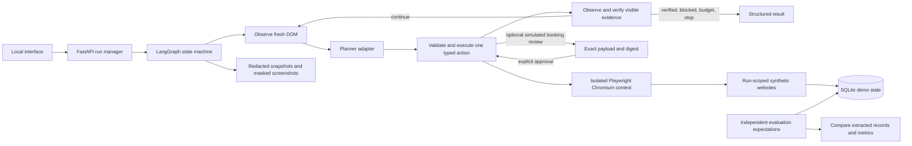

# Architecture and learning path

The research question is whether a bounded agent can turn an English request into
browser actions and establish completion from evidence. Version 1 deliberately
limits the environment so execution, verification, and evaluation can be studied
without real accounts or commitments.

## Read the implementation in this order

1. `models.py`: task contract, tool variants, observations, and explicit run state.
2. `demos.py`: the three small websites and their server-side validation.
3. `browser.py`: deterministic tool execution, observation, request policy, review,
   duplicate prevention, screenshots, and browser cleanup.
4. `planners.py`: an inspect-and-react scripted policy, a fixed sequence baseline,
   and the real Responses API adapter. None receives a browser object.
5. `verification.py`: what visible evidence actually counts as completion.
6. `agent.py`: four graph nodes, conditional edges, budgets, errors, and stop states.
7. `evaluation/runner.py`: independent checks, separate from the runtime verifier.
8. `api.py` and `static/`: run management and the small no-build interface.

## State and stopping

`queued → running → succeeded | blocked | budget_exceeded | stopped | failed`.
An optional `awaiting_review → running` transition gates a simulated booking.
The state includes the interpreted task contract, latest observation, action count,
consecutive retries, failure counts, extraction, history, screenshots, usage, and result.

Bootstrap navigation counts as action 1. Each proposed tool invocation, including a
failed attempt, inspect, screenshot, or finish request, counts toward the action budget.
The executor's automatic observations and screenshots are instrumentation and do not
count as additional tool actions. A default run permits 25 actions and 90 seconds;
configuration caps these at 60 and 180. Wall-clock time includes browser startup,
planning, screenshots, and review waiting. Cleanup is awaited and may extend beyond
the deadline; the deadline prevents further task work, rather than killing processes.

There is at most an initial failing action plus two consecutive retries by default.
A successful action resets that counter. Total actions still bound planners that
alternate between successful and unsuccessful actions. A missing element is re-observed
before a new decision. A changed search label is handled by the reactive scripted
policy. A transient timeout is covered by an injected-failure browser test.

## Trust boundaries

- The selected workflow and user task establish scope. The model receives page data
  in an explicitly untrusted observation field. Imported instructions cannot authorize
  navigation or actions. System prompting is defense in depth; code enforces the boundary.
- Navigation and every browser HTTP request must match the exact configured loopback
  scheme, host, port, and `/demo/<run-id>/` path. Only two fixed static demo assets are
  permitted outside that path. HTTP requests are fetched with redirects disabled;
  all 3xx responses fail closed before following Location, even for local destinations.
  The three demos use direct navigation and do not need redirects. Control APIs,
  other runs, external resources, service workers, WebSockets, downloads, and popups
  are outside the browser's scope. Hostname suffix matching is never used.
- Model tools accept typed data, semantic targets, and fixed extraction schemas.
  There is no model-facing shell, arbitrary selector, browser script, or filesystem API.
  The executor owns a fixed DOM reader and a fixed catalog extraction function.
- The local form can only prepare a draft. The booking website only creates a
  `simulated=true` SQLite record. No real-service integration exists in version 1.
- Optional review shows the exact fictional booking fields. Approval is bound to a
  SHA-256 digest of action, URL, and current fields, and is consumed once. A changed
  payload requires a new review. Website copy cannot change the review setting.
- Real actions are deliberately unsupported. A future connector would need its own
  trusted action classification and mandatory explicit authorization; the demo's
  `data-effect` marker is not a general authorization mechanism for arbitrary websites.

## Evidence and idempotency

Catalog success requires an actual search URL with the requested filters, extraction
from the current page, and an exact second read of the visible table. An empty table
is a valid, explicitly labeled outcome. The form and booking workflows require a
visible receipt whose fields and receipt type match the task contract. A planner's
`finish_task` request cannot create success.

The executor records a draft/booking submission attempt **before** clicking and will
not click that effect again in the same run. A timed-out submission can be reconciled
by reloading its persisted receipt. SQLite also has a unique record per run. An
identical duplicate API request returns the same record; a conflicting request fails.
This is per-run idempotency, not global appointment capacity management: each run is
an isolated simulation.

Evaluation bypasses the runtime verifier: it compares hand-authored expectations
against SQLite records and the actual extracted rows. This detects a wrong parsed
intent or a misleading success claim that runtime verification alone could miss.

## Data handling and local operation

Inputs must be synthetic. Common password assignments, API-key patterns, and payment
numbers are rejected. Traces redact secret-like keys and patterns, payment-number
patterns, and emails (including encoded email URLs). Screenshots mask inputs,
private receipt fields, and imported injection notes. Pattern-based redaction is
not a general PII detector: names and free text can remain visible in traces.

SQLite stores the fictional demo form and booking details to support independent
grading. Raw browser observations and the task exist in process memory during a run.
In LLM mode those synthetic details go to the configured model provider. Redacted
snapshots, screenshots, and evaluation reports live in ignored `.runtime/`; there
are no Playwright trace ZIPs, persistent browser profiles, passwords, or payments.

The control app binds to `127.0.0.1`, checks Host, rejects cross-origin mutations,
requires JSON writes, and uses a same-origin content security policy. It has no user
authentication and is intended for one developer's machine. Do not expose it to a
public network. At most two interactive runs can be active; evaluation runs sequentially.
Server restart marks interrupted snapshots stopped; it does not replay actions.

## Version 1 boundaries

Three specific DOM-based sites, fixed demo dates and UTC, one browser engine, one
process, small datasets, and no general navigation across the web. There is no OCR,
CAPTCHA handling, authentication, distributed queue, durable browser recovery,
multi-user authorization, or production deployment. These are optional extensions,
not hidden capabilities of the MVP. PostgreSQL would replace the store behind its
small interface after migrations and concurrency semantics are designed.
